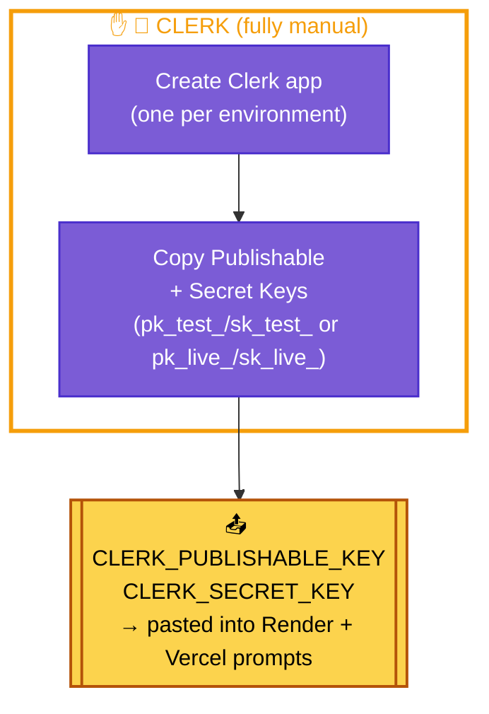
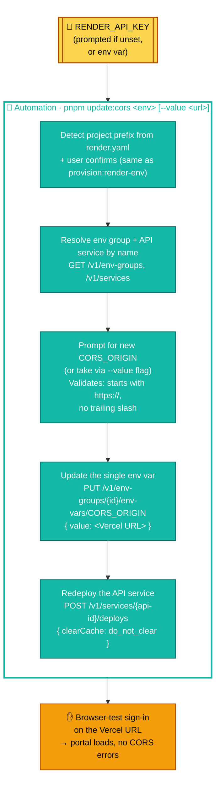
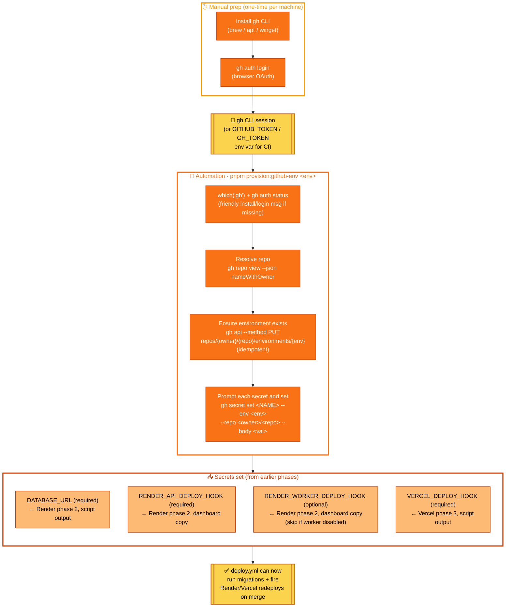

# Deployment Setup Flow

A visual map of the one-time setup required to provision a new deployed environment across Clerk, Render, Vercel, and GitHub Environments. Use this alongside the step-by-step guides:

- [`STAGING_ENV.md`](STAGING_ENV.md) — the canonical path this diagram follows
- [`PROD_ENV.md`](PROD_ENV.md) — production variant (uncomment `render.yaml` prod block, target `main`)
- [`NEW_ENV.md`](NEW_ENV.md) — adding another environment (e.g. `preview`)
- [`ENV_VARS.md`](ENV_VARS.md) — the full list of secrets each service needs

The labels on the arrows between phases are the **artifacts each phase produces** and the next phase consumes. Most setup mistakes happen when one of these is copied incorrectly (CORS mismatch, wrong deploy hook, missing `?sslmode=require`).

> **Note:** Diagrams use saturated fills with white text so they stay readable in both light and dark GitHub themes.
>
> **Automation legend:** ✋ = must be done manually (human in a dashboard UI) · 🤖 = can be automated (via CLI, API, script, or CI workflow). Use the 🤖 markers to prioritize what to script when onboarding new environments.

---

## Overview

**Solid arrows** = sequencing (do these in order). **Dashed arrows** = data that jumps past the sequence — a secret produced in one phase that feeds a later non-adjacent phase.

```mermaid
---
config:
  layout: elk
  elk:
    nodePlacementStrategy: LINEAR_SEGMENTS
---
flowchart LR
    Start([Fresh fork]):::endpt
    A["🔐 1 · Clerk<br/>Auth"]:::clerk
    B["🟢 2 · Render<br/>Backend"]:::render
    C["▲ 3 · Vercel<br/>Frontend"]:::vercel
    D["🔄 4 · Wire CORS<br/>(on Render)"]:::wire
    E["🐙 5 · GitHub<br/>Environments"]:::gh
    Done([CI/CD live]):::endpt

    Start --> A
    A -->|Clerk keys| B
    B -->|NEXT_PUBLIC_SERVER_URL| C
    C -->|Vercel domain| D
    D --> E
    E --> Done

    A -. Clerk keys .-> C
    B -. DATABASE_URL<br/>RENDER_API_DEPLOY_HOOK .-> E
    C -. VERCEL_DEPLOY_HOOK .-> E

    classDef endpt fill:#6B7280,stroke:#374151,color:#fff,stroke-width:2px
    classDef clerk fill:#7B5CD6,stroke:#4A2FCC,color:#fff,stroke-width:2px
    classDef render fill:#10B981,stroke:#065F46,color:#fff,stroke-width:2px
    classDef vercel fill:#EC4899,stroke:#BE185D,color:#fff,stroke-width:2px
    classDef wire fill:#14B8A6,stroke:#0F766E,color:#fff,stroke-width:2px
    classDef gh fill:#F97316,stroke:#C2410C,color:#fff,stroke-width:2px
```

---

## 1 · Clerk — Auth

**Targets:** Clerk Dashboard
**Produces:** `CLERK_PUBLISHABLE_KEY`, `CLERK_SECRET_KEY` (reused by both Render and Vercel)

Fully manual — no automation layer. The keys are collected once and pasted into Render + Vercel's interactive prompts later. Per-environment Clerk apps keep test/live keys isolated (one Clerk app per deployed environment).

---

## 2 · Render — Backend

**Targets:** Render dashboard (API, worker, Postgres, Redis)
**Produces:** `DATABASE_URL` (fetched via API), `RENDER_API_DEPLOY_HOOK` + `RENDER_WORKER_DEPLOY_HOOK` (copied from dashboard — Render's public API does not expose deploy-hook URLs)

```mermaid
flowchart TB
    subgraph MANUAL["✋ Manual prep (one-time per workspace)"]
        direction TB
        R1["Sign up (client email)"] --> R2["Add payment + upgrade to Professional"]
        R2 --> R3["Install Render GitHub App on org"]
        R3 --> R4["New → Blueprint<br/>→ connect repo + branch (develop)"]
        R4 --> R5["Sync render.yaml<br/>→ services + env group created"]
        R5 --> KGEN["Generate API Key<br/>(Account → API Keys)"]
    end

    KGEN --> KEY[["🔑 RENDER_API_KEY<br/>(prompted on first run,<br/>or RENDER_API_KEY env var)"]]
    KEY --> AUTO

    subgraph AUTO["🤖 Automation · pnpm provision:render-env &lt;env&gt;"]
        direction TB
        A1["Detect project prefix from render.yaml<br/>→ user confirms"] --> A2["Resolve resources by name<br/>GET /v1/services?name=…<br/>GET /v1/env-groups?name=…<br/>GET /v1/postgres?name=…"]
        A2 --> A3["Prompt for each secret (required + optional)<br/>+ auto-fill S3_REGION=auto, S3_BUCKET=file-uploads<br/>→ PUT /v1/env-groups/{id}/env-vars/{key}<br/>(per-key upsert; no bulk-replace endpoint)"]
        A3 --> A4["Fetch Postgres External URL<br/>GET /v1/postgres/{id}/connection-info<br/>→ append ?sslmode=require"]
        A4 --> A5["Run migrations<br/>pnpm --filter server db:migrate<br/>with DATABASE_URL env<br/>(aborts run if migration fails)"]
        A5 --> A6["Trigger redeploys<br/>POST /v1/services/{id}/deploys<br/>on API + worker (if present)"]
    end

    AUTO --> POST

    subgraph POST["✋ Final manual step (once per service)"]
        direction TB
        PH["Script prints deep-links:<br/>https://dashboard.render.com/web/&lt;id&gt;/settings#deploy-hook<br/>Open → Copy<br/>(API doesn't expose these URLs)"]
    end

    POST --> OUT[["📤 DATABASE_URL<br/>RENDER_API_DEPLOY_HOOK<br/>RENDER_WORKER_DEPLOY_HOOK<br/>→ fed into GitHub provisioner (phase 5)"]]

    classDef step fill:#10B981,stroke:#065F46,color:#fff,stroke-width:1.5px
    classDef keyArt fill:#FCD34D,stroke:#B45309,color:#000,stroke-width:2px
    classDef manualStep fill:#F59E0B,stroke:#B45309,color:#000,stroke-width:1.5px
    class R1,R2,R3,R4,R5,KGEN step
    class A1,A2,A3,A4,A5,A6 step
    class PH manualStep
    class KEY,OUT keyArt
    style MANUAL fill:transparent,stroke:#F59E0B,stroke-width:3px,color:#F59E0B
    style AUTO fill:transparent,stroke:#10B981,stroke-width:3px,color:#10B981
    style POST fill:transparent,stroke:#F59E0B,stroke-width:3px,color:#F59E0B
```

One-time manual workspace prep (sign-up, billing, GitHub App install, initial Blueprint sync) culminates in generating a **Render API Key** — the handoff artifact that unlocks `pnpm provision:render-env <env>`. After that, almost everything is scripted via the Render REST API. The only step that stays manual is *copying* each service's deploy-hook URL from its Settings page, because Render has no API or CLI for retrieving them (confirmed against the public OpenAPI spec and the `render-oss/cli` source).

---

## 3 · Vercel — Frontend

**Targets:** Vercel dashboard
**Produces:** `VERCEL_DEPLOY_HOOK` (auto-created + printed by the script), `.vercel.app` subdomain, first deployment triggered

Sign-up, Pro upgrade, and installing the Vercel GitHub App are one-time manual steps. Authentication is then via browser OAuth (`pnpm dlx vercel login` writes a token to `~/Library/Application Support/com.vercel.cli/auth.json` on macOS), with `VERCEL_TOKEN` env var as the CI fallback. The script only assigns `.vercel.app` subdomains — if you want a custom domain (e.g. `staging.example.com`), finish this phase with a `.vercel.app` value first, then follow [`CUSTOM_DOMAIN.md`](integrations/CUSTOM_DOMAIN.md) post-launch (DNS setup + `pnpm update:cors` to point Render at the new URL).

```mermaid
flowchart TB
    subgraph MANUAL["✋ Manual prep (one-time per workspace)"]
        direction TB
        V1["Sign up (client email)"] --> V2["Upgrade to Pro"]
        V2 --> V3["Install Vercel GitHub App on org"]
        V3 --> VAUTH["pnpm dlx vercel login<br/>(browser OAuth → token on disk)<br/>or set VERCEL_TOKEN env var"]
    end

    VAUTH --> KEY[["🔑 VERCEL_TOKEN<br/>(read from auth.json<br/>or env var fallback)"]]
    KEY --> AUTO

    subgraph AUTO["🤖 Automation · pnpm provision:vercel-env &lt;env&gt;"]
        direction TB
        A1["Resolve owner<br/>GET /v2/teams → pick team or personal<br/>GET /v2/user for slug (dashboard URLs)"]
        A2["Ensure project exists<br/>GET /v9/projects/{name} → 404 →<br/>POST /v11/projects with git link,<br/>framework=nextjs, rootDir=apps/web,<br/>installCommand=pnpm install --frozen-lockfile"]
        A3["Ensure custom env (non-prod)<br/>GET /v9/projects/{id}/custom-environments<br/>→ POST if missing<br/>with branchMatcher equals &lt;branch&gt;"]
        A4["Disable Deployment Protection (non-prod)<br/>PATCH /v9/projects/{id}<br/>{ ssoProtection: null }"]
        A5["Prompt + upsert env vars<br/>auto-fills NEXT_PUBLIC_NODE_ENV,<br/>Clerk sign-in/up URLs<br/>POST /v10/projects/{id}/env?upsert=true"]
        A6[".vercel.app subdomain prompt<br/>(non-.vercel.app input rejected<br/>with pointer to CUSTOM_DOMAIN.md)<br/>POST /v10/projects/{id}/domains<br/>· 409 handled (taken elsewhere = re-prompt)"]
        A7["Create deploy hook<br/>GET project.link.deployHooks → reuse<br/>or POST /v2/projects/{id}/deploy-hooks<br/>(undocumented; used by vercel CLI)"]
        A8["Trigger first deployment<br/>POST &lt;hook URL&gt;<br/>→ job id + dashboard link"]
        A1 --> A2 --> A3 --> A4 --> A5 --> A6 --> A7 --> A8
    end

    AUTO --> OUT[["📤 VERCEL_DEPLOY_HOOK<br/>(printed at end → user saves<br/>for GitHub provisioner phase 5)"]]

    OUT -. optional, post-launch .-> V8["✋ Swap .vercel.app → custom domain<br/>Follow docs/setup/integrations/CUSTOM_DOMAIN.md<br/>(DNS at registrar + pnpm update:cors)"]

    classDef step fill:#EC4899,stroke:#BE185D,color:#fff,stroke-width:1.5px
    classDef keyArt fill:#FCD34D,stroke:#B45309,color:#000,stroke-width:2px
    classDef optional fill:#6B7280,stroke:#374151,color:#fff,stroke-width:2px
    class V1,V2,V3,VAUTH step
    class A1,A2,A3,A4,A5,A6,A7,A8 step
    class KEY,OUT keyArt
    class V8 optional
    style MANUAL fill:transparent,stroke:#F59E0B,stroke-width:3px,color:#F59E0B
    style AUTO fill:transparent,stroke:#EC4899,stroke-width:3px,color:#EC4899
```

---

## 4 · Wire CORS — on Render

**Targets:** Render env group `<env>-secrets` + API service
**Consumes:** Vercel domain from phase 3 · **Updates:** `CORS_ORIGIN` and redeploys the Render API

Connects the frontend and backend so sign-in works end-to-end. The Vercel `provision:vercel-env` run in phase 3 left `CORS_ORIGIN` on Render pointing at a placeholder (`http://localhost:3001`); this phase repoints it at the real Vercel URL and redeploys so the Render API picks up the change.

Fully scripted. Reuses the same `RENDER_API_KEY` prompt pattern as `provision:render-env` — you're back in and out in one command per env.

---

## 5 · GitHub Environments

**Targets:** GitHub repo (via `gh` CLI)
**Consumes:** `DATABASE_URL` + deploy-hook URLs from phases 2 and 3 · **Stores:** everything `deploy.yml` needs at CI time

The simplest of the five phases. `deploy.yml` runs migrations and fires deploy hooks on merge; this phase makes those values available as GitHub environment secrets. Once `gh` is authenticated, everything is scripted — there are no dashboard visits.

---

## Tips for viewing

- On **GitHub**, Mermaid blocks render as static SVGs sized to the column width. Clicking the diagram opens it in a lightbox where you can zoom.
- In **VS Code**, install the *Markdown Preview Mermaid Support* extension to preview locally.
- For an interactive pan-and-zoom view, copy any block into the [Mermaid Live Editor](https://mermaid.live).
